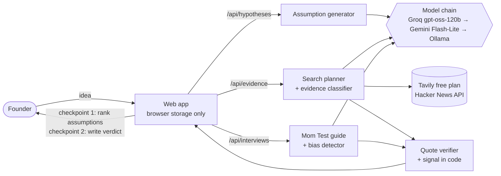

# Assumption Breaker: Devpost submission sections

Ready to paste into the Devpost project page. Figures marked **[TO MEASURE]** come from the field tests and must be filled in before submitting.

- Live demo: https://assumption-breaker.vercel.app (no account, no setup, English and French)
- Code: https://github.com/finere-dem/assumption-breaker

---

## Inspiration

Most startups do not fail because they cannot build. They fail because nobody needed what they built, and the founder found out too late. Testing an idea properly is slow (listing assumptions, digging for evidence, preparing interviews that do not lead the witness, re-reading notes honestly), so most founders skip it, or ask an AI that cheerfully tells them their idea is great.

We wanted the opposite: an agent that does the slow research work, and then hands every decision back to the founder, with the evidence in front of them.

## What it does

1. **Idea.** The founder describes the idea in a few sentences.
2. **Assumptions.** The agent lists 5 to 7 assumptions that must be true for the idea to work (desirability, feasibility, viability), with why each one is uncertain and what happens if it is wrong. **The founder edits, adds, picks and ranks up to 3.** Nothing continues until they do.
3. **Evidence.** For each ranked assumption, the agent plans searches designed to *disprove* it, reads the sources, and returns evidence **for and against**, each with a verbatim quote (translated if needed) and its link. The founder can dismiss any piece of evidence; the signal is recomputed.
4. **Interviews.** The agent writes an interview guide following *The Mom Test* (past behaviour, no pitching, no "would you buy?") and lists the tempting questions to avoid. **The founder talks to real people.** They paste their notes and a bias detector flags leading questions, hypotheticals, pitching, compliments taken as evidence, vague answers, and conclusions the facts do not back. It also extracts the facts actually learned.
5. **Verdict.** A summary of web and field evidence per assumption. **The founder chooses continue, pivot or stop and must write why.** The full report downloads as Markdown.

## How we built it

- Next.js 16 + TypeScript, deployed on Vercel (free plan). No database: the session lives in the founder's browser.
- Every model call goes through one module (`src/lib/llm.ts`) that talks to OpenAI-compatible endpoints and falls back from Groq to Google Gemini to a local Ollama model when a free quota is reached. Every answer is validated against a schema (Zod), with one corrective retry.
- Evidence search: Tavily (free plan) for the web, the public Hacker News API for forums.
- Guardrails written in code, not left to the model:
  - every quote and every interview excerpt is checked word for word against its source; an invented quote is dropped and counted on screen;
  - the evidence signal (insufficient / leans supported / leans contradicted / mixed) is computed from verified evidence by a pure function, never by the model; fewer than 2 pieces of evidence means "insufficient evidence";
  - syndicated copies of the same article count once.

### Architecture

## Challenges we ran into

- **Free models invent quotes.** In early runs, up to 6 quotes per analysis did not exist in the source. We stopped trusting the model and verify every quote in code.
- **Free-tier limits.** Groq's free tier allows 8,000 tokens per minute: the agent waits when the provider asks it to, and falls back to Gemini when a quota is exhausted. The built-in example is precomputed so demo visitors spend no quota.
- **Language.** Sources are mostly in English while our users write in French: quotes are verified in the original language and shown translated, and one search per assumption is made in the founder's language to reach local sources.
- **Models retire fast.** Two of our planned models (Llama 3.3 on Groq, Gemini 2.5 Flash-Lite for new accounts) disappeared during the build; model names are configuration, not code.

## Accomplishments that we're proud of

- An agent that is useful precisely because it refuses to decide.
- On a synthetic biased interview, the detector flags 4 to 5 traps, including the founder's own conclusion "Hypothesis validated" when the interviewee actually eats at a 3.30 EUR university cafeteria every day.
- A complete run costs 0 EUR.

## What we learned

Making an AI agent reliable is mostly about what you do *not* let the model decide. And founders, like us, love hearing that their idea is good.

## What's next

- Export to Notion / Google Docs, and a shareable read-only report link.
- Track assumptions over time (re-test after new interviews).
- A fully local mode packaged for founders who cannot send their idea to any third party.

---

## AI Disclosure Statement

### Models and services used by the agent at runtime

| Model / service | Provider | Role in the agent | Plan | Calls per run |
|---|---|---|---|---|
| `openai/gpt-oss-120b` (open-weight, Apache 2.0) | Groq | Main model: assumptions, search plans, evidence classification and translation, interview guide, bias detection | Free tier | 9 |
| `gemini-3.5-flash-lite` | Google AI Studio | Fallback only, when Groq's free quota is reached or Groq is down | Free tier | 0 in a normal run |
| Any open-weight model (e.g. Llama) | Ollama, local | Optional, fully local mode | Free, local | 0 by default |
| Tavily Search | Tavily | Web search for evidence (4 queries per assumption) | Free plan, 1,000 credits/month | 12 searches |
| Hacker News search | Algolia public API | Forum evidence | Free, public | 12 searches |

**Estimated consumption for a full run** (3 assumptions, interview guide, one notes analysis): about **9 model calls and 15,000 tokens** (measured: 1,500 to 2,000 tokens for the assumptions, 3,500 to 5,000 per assumption tested, about 2,500 for the guide plus the notes analysis). Cost: **0 EUR**. The built-in example is precomputed and costs 0 tokens per visitor.

No paid plan, credit or subscription is used at runtime.

### AI tools used to build the project

The code was written with the help of **Claude Code** (Anthropic), used as a coding assistant. Claude is not called by the agent at runtime.

---

## Time-Saved Report

**Task:** testing whether a startup idea holds up before investing in it: listing the risky assumptions, finding evidence for and against each one, and preparing unbiased customer interviews.

**Protocol.** [TO MEASURE] people with a real project idea (students or early-stage founders). For each one, we time two runs on two comparable assumptions:
- *Manual:* the person lists assumptions, searches Google/forums for evidence for and against one assumption, and writes 5 interview questions.
- *With the agent:* same task with Assumption Breaker, including the time spent reviewing and dismissing evidence.

| Tester | Idea (one line) | Manual | With the agent | Saved |
|---|---|---|---|---|
| 1 | [TO MEASURE] | [ ] min | [ ] min | [ ] |
| 2 | [TO MEASURE] | [ ] min | [ ] min | [ ] |
| 3 | [TO MEASURE] | [ ] min | [ ] min | [ ] |

**Quality, not only speed:** in each manual run we also count the interview questions that are leading or hypothetical, and the evidence *against* the idea that was found. [TO MEASURE]

**Agent run time:** about 1 minute of machine time for 3 assumptions; the rest is the founder reading and deciding, which is the point.

---

## Human Judgment

| The agent does | The founder decides |
|---|---|
| Proposes the assumptions behind the idea and explains why each is risky | Which assumptions matter, how they are worded, and their order of risk (checkpoint 1, blocking) |
| Plans searches that try to disprove each assumption, reads sources, shows quotes for and against | Which evidence actually applies to their idea (dismiss button; the signal updates) |
| Writes a Mom Test interview guide and lists bad questions to avoid | Who to interview, and runs every interview personally: the agent cannot do this step |
| Flags biases in the founder's own notes and extracts concrete facts | Whether the flags are fair |
| Summarises web and field evidence per assumption | **Continue, pivot or stop, with a written reason (checkpoint 2, blocking)** |

**Why.** Deciding whether to spend the next year on an idea depends on things no model knows: the founder's constraints, conviction, network and appetite for risk. An agent that answers "your idea is viable: 7/10" removes the thinking the founder most needs to do. So the agent never scores the idea, never recommends a decision, and its evidence signal is a plain count of verified evidence that the founder can inspect and override. The design goal is that the founder leaves *more* critical of their idea than they arrived, with the evidence to say why.

---

## Responsible AI

**Data.** The founder's idea and interview notes are stored only in their own browser (localStorage); we have no database and no accounts. To be analysed, the text is sent to Groq; if Groq is unavailable, to Google Gemini, whose free tier allows Google to use the data to improve its products. Search providers receive only short keyword queries. The interface says this on the first screen and asks users not to paste confidential information. Users who need full confidentiality can run the open-source code locally with Ollama.

**Interview data.** Notes may contain information about third parties. The interface asks founders to remove names and personal details before pasting. The demo uses a synthetic interview; no real person's data is included.

**Known limitations.**
- The free models misjudge some evidence (e.g. a source about security re-scanning classified as customers disliking self-scanning). Every piece of evidence shows its source and can be dismissed.
- Bias detection varies between runs: a trap flagged once may be missed the next time. It is a second pair of eyes, not a guarantee.
- Web evidence is skewed towards English-language, online, and often US-centric sources; markets with little online coverage (for example West Africa) will often get "insufficient evidence". That is the honest answer, and the cue to go interview people.
- Verifying that a quote exists does not verify that the source is right.
- Evidence counts are not statistics: 3 articles "for" do not make an idea 3 times more likely to work.

**Failure cases handled.** Provider quota or outage: wait and retry, then fallback model, then a clear "retry in a minute" message. Invalid model output: schema validation and one corrective retry. Invented quotes: removed and counted on screen. No usable sources: "insufficient evidence", never a guess.
